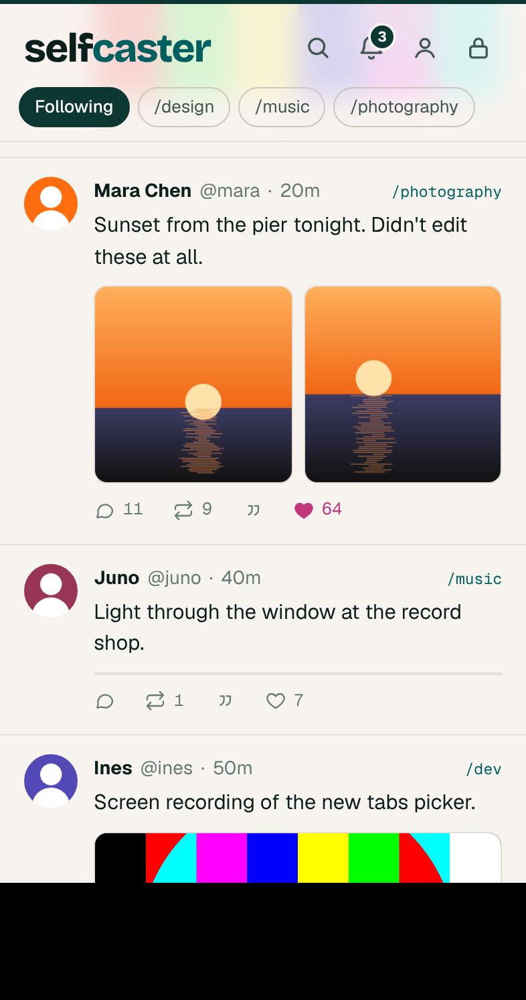
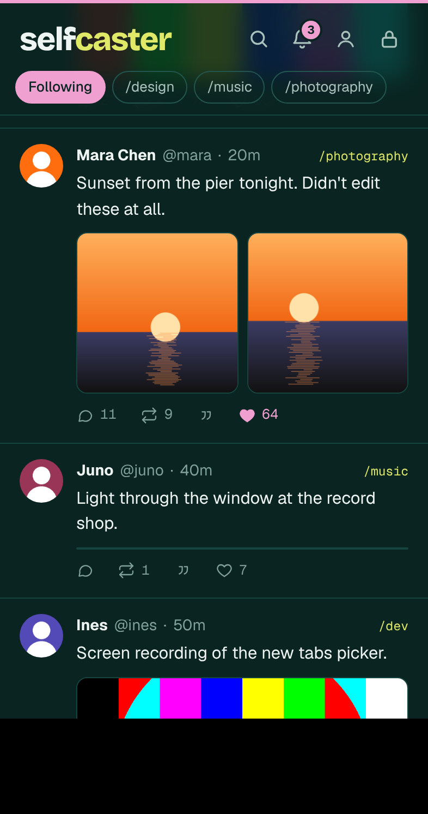

<p align="center"></p>

<h1 align="center">Jackcaster</h1>

<p align="center">A personal Farcaster client built on Selfcaster.<br>Chronological feeds, no algorithm, hosted on your own Vercel.</p>

<p align="center"><a href="https://vercel.com/new/clone?repository-url=https%3A%2F%2Fgithub.com%2Fwlplease%2Fjackcast&project-name=jackcast&repository-name=jackcast&env=NEYNAR_API_KEY,APP_PASSWORD&envDescription=NEYNAR_API_KEY%20is%20your%20key%20from%20dev.neynar.com.%20APP_PASSWORD%20locks%20your%20client%3A%20anyone%20with%20it%20can%20post%20as%20you%2C%20so%20make%20it%20long.&envLink=https%3A%2F%2Fgithub.com%2Fwlplease%2Fjackcast%23setup&stores=%5B%7B%22type%22%3A%22blob%22%2C%22access%22%3A%22public%22%7D%5D"></a></p>

> **Jackcaster** is the app name; **Jackcast** is the repository name. This is an open-source, single-owner fork built on [Selfcaster by GenuineJack](https://github.com/GenuineJack/selfcaster). It keeps the original project's MIT license and credits, while adding optional features for this deployment. It is independent and is not an official Selfcaster release. See [FORK-NOTES.md](./FORK-NOTES.md) for maintenance details and [RELEASE-NOTES.md](./RELEASE-NOTES.md) for the current change summary.

<p align="center">
  
  &nbsp;
  
</p>

## How Jackcaster relates to Selfcaster

Selfcaster is the original Farcaster client created and maintained by [GenuineJack](https://github.com/GenuineJack). Its source is at [GenuineJack/selfcaster](https://github.com/GenuineJack/selfcaster), and the original app is at [selfcaster.xyz](https://selfcaster.xyz/). Jackcaster starts from that open-source foundation and keeps its MIT license and attribution.

Jackcaster is maintained separately in [wlplease/jackcast](https://github.com/wlplease/jackcast). It is a personal fork for a single-owner deployment, with its own branding and workflow changes. It is not affiliated with or an official release from GenuineJack. Upstream Selfcaster remains the source for the original app; Jackcaster-specific additions and decisions are documented here for review and selective upstream discussion.

The shared foundation includes the Farcaster client, Neynar integration, in-browser signer setup, posting, profiles, and the original project license. Jackcaster adds focused personal feeds, Recasts separation, Friends activity tools, feed controls, profile analytics, Mini Apps discovery, a dedicated settings screen, feed continuation, and the optional AI digest. These additions are maintained in this fork; they do not change Selfcaster or affect its users.

Each deployment is hosted and configured by its operator. Neynar, Vercel, Google Gemini, and ElevenLabs are external services with their own keys, terms, availability, and possible costs. Jackcaster does not bundle their services or claim that every dependency is self-hosted. See [SECURITY.md](./SECURITY.md) and the setup guide before connecting an account.

Compared with the upstream project, Jackcaster adds:

- **More focused timelines:** separate Friends, Recasts, and named custom feeds, followed-account search, reply and mini-app filters, repeated-link grouping, and per-feed scroll restoration. Recasts by people you follow have their own tab and stay out of the regular feeds.
- **Richer profile and posting tools:** Posts and Media profile tabs, a pinned cast, optional cover editing, local drafts, and a thread composer with partial-send recovery.
- **Optional AI catch-up:** a user-triggered Gemini digest with optional ElevenLabs speech. Provider keys stay server-side; see the privacy and cost notes below before enabling them.
- **Fork-specific hardening and polish:** responsive feed media and page layouts, server-side input and upload bounds, safer errors, baseline security headers, and documented security decisions.

These are Jackcast-specific choices, not a claim that Selfcaster should adopt every feature. See [FORK-NOTES.md](./FORK-NOTES.md) for the detailed comparison, [RELEASE-NOTES.md](./RELEASE-NOTES.md) for the current change summary, and [UPSTREAM-ISSUE-DRAFT.md](./UPSTREAM-ISSUE-DRAFT.md) for a proposed discussion with the upstream maintainer.

## What you get

- **A calm Following feed.** Newest first, every time. A caught-up line where you left off, and a "new casts" pill instead of the page jumping around. Following and Friends can append more posts as you scroll. Posts shared by people you follow appear in their own Recasts tab.
- **Favorite channels.** Search every channel you follow and pick a few. They become your feed tabs and the only channels in the composer.
- **A Friends feed.** Search the accounts you already follow or scan recent Following posts to suggest active people from the last 90 days (up to 1,000 posts per scan). Suggestions are cached for a day; the weekly saved-Friends activity check is cached for a week. Review the selected list and remove people in Settings. The list is private to this app and saved on this device.
- **A custom feed.** Search accounts you already follow by name or username, add up to 20, and name the tab (for example, Builders or Local). Review and edit the selected list in settings; Following, Friends, and this custom feed stay separate.
- **Profiles.** Browse posts or media, pin one cast on your Selfcaster profile, and set an optional Farcaster profile cover (Neynar Pro required to update the cover).
- **Posting that works.** Photos (up to 2, compressed on your phone first), links, quote casts, replies, threads with context.
- **Media inline.** Farcaster videos, YouTube, Spotify, SoundCloud, Bandcamp and archive.org play right in the feed.
- **Your filters.** Mute words or phrases to quiet recurring topics, or mute an `@handle` to hide that account and posts mentioning it. A quality dial can also hide low-score accounts. These controls are optional and can be reversed in Settings.
- **Repeated links grouped.** When several casts share the same destination, the newest stays in the feed and the others open underneath it. Turn this off in Settings → Feed controls if you want every post shown separately.
- **A calmer feed.** Filter replies and Neynar-detected mini apps, keep a separate scroll position for each feed, and tap an image to expand it without leaving the timeline.
- **Drafts and threads.** Composer drafts stay in this browser. The thread composer posts a reply chain of up to five casts and keeps unsent text if a later post fails.
- **Optional AI catch-up and audio.** Open the AI icon to ask Gemini for a concise storyline plus 2–4 sections grouped by topic, based on up to 20 loaded posts in Following. The digest stays out of the feed unless opened from the icon; its options let you redo or clear it. Optionally have ElevenLabs read it aloud. Add `GOOGLE_AI_API_KEY` for the digest; add `ELEVENLABS_API_KEY` and `ELEVENLABS_VOICE_ID` for audio. Google receives selected post text and author names; ElevenLabs receives only the generated digest. Audio is created on demand and kept in the browser for that visit.
- **Themes.** Selfcaster, Orange, Stone, Farcaster, Higher, Twitter and X, each in light and dark. Every color is contrast-checked.
- **The rest.** Search, notifications, profiles, your posting stats, edit your profile, installable as an app on your phone.
- **Mini Apps.** Explore Neynar's 7-day trending catalog, apps relevant to your network, and search. Open apps in Farcaster's native Mini App surface when Jackcaster is hosted there, or use the isolated in-app web preview in a regular browser. Filter by available categories, save up to six apps on this device, and see creator-identified apps from your casts in the Dev section. Catalog data is cached for a week to limit repeat API pulls. Native wallet and Farcaster actions require the official host; the browser preview does not grant those capabilities. Launch behavior follows the official [Mini App detection](https://miniapps.farcaster.xyz/docs/sdk/is-in-mini-app) and [`openMiniApp`](https://miniapps.farcaster.xyz/docs/sdk/actions/open-miniapp) SDK guidance.
- **One settings home.** Use the gear icon for themes, channel tabs, Friends, Custom, filters, and connection details. The profile icon opens your profile and analytics.
- **Keep reading.** Following and Friends append more posts as you scroll, with a manual Load more button if automatic loading is unavailable. The AI digest opens in its own panel from the AI icon and stays out of the post list.
- **Service status.** When Neynar, Gemini, or ElevenLabs has a configuration, quota, or availability problem, Jackcast explains what happened and whether to check settings or try again. AI remains optional; the core app works without Google or ElevenLabs keys.

What it doesn't do: DMs (on purpose), ads, an algorithm, or tracking.

**AI is completely optional.** Jackcast works without Google or ElevenLabs keys; AI controls appear only when you configure the related server-side environment variables.

## What you need

- A **GitHub** account (free) and a **Vercel** account (the free Hobby plan is enough).
- A **Neynar API key** from [dev.neynar.com](https://dev.neynar.com). Neynar is the API Selfcaster reads and writes through. Their free plan is enough to try it; reading, posting and the connected account all use credits, so a daily user will likely want a paid plan. See [neynar.com/pricing](https://neynar.com/pricing).
- Your **Farcaster account** and its **recovery phrase**, used once in your browser to approve the app. More on that below.

## Setup

About 10 minutes, no Terminal.

### 1. Get a Neynar API key

Sign up at [dev.neynar.com](https://dev.neynar.com) and create an API key.

### 2. Click Deploy

Hit the **Deploy with Vercel** button above. Vercel will:

1. make your own copy of this repo in your GitHub,
2. create a public Blob store for your photos,
3. ask for two values:

| Var | Value |
| --- | --- |
| `NEYNAR_API_KEY` | your key from step 1 |
| `APP_PASSWORD` | something long. Anyone with it can post as you. |

Then it builds and gives you a URL.

### 3. Connect your account at `/setup`

Open your URL, enter your password, and you'll land on `/setup`.

1. Paste your Farcaster recovery phrase (Farcaster app settings, usually under Advanced). The page signs one key request **in your browser** and clears it. The phrase is never sent to the server or saved. See [SECURITY.md](./SECURITY.md).
2. Approve in the Farcaster app: scan the QR on desktop, or tap **Open in Farcaster** on your phone.
3. Done. That device is connected.

The last screen shows `SIGNER_UUID` and `MY_FID`. Add both in Vercel (**Settings, Environment Variables**) and redeploy, so every device is connected, not just this one.

Rather not use your main recovery phrase? Make a separate Farcaster account just for this and use its phrase. You still approve and post as *you*. The other account only shows up as the app that asked.

To revoke access later: Farcaster app settings, connected apps.

### 4. Put it on your phone

Open your URL in Safari or Chrome and **Add to Home Screen**.

<details>
<summary>Prefer to set it up by hand?</summary>

1. On GitHub, **Use this template**, **Create a new repository**.
2. In Vercel, **Add New, Project**, import it, and add `NEYNAR_API_KEY` and `APP_PASSWORD` before deploying.
3. For photos: **Storage, Create, Blob**, choose **Public**, connect it to the project, redeploy. (A private store works too. Selfcaster serves those photos itself at `/i/...` so other clients can see them.)
4. Continue with step 3 above.

</details>

## Make it yours

- **Name and wordmark:** `lib/brand.ts`.
- **Icons:** replace the PNGs in `public/` (`icon-192.png`, `icon-512.png`, `icon-maskable-512.png`, `apple-touch-icon.png`, `favicon.ico`, `favicon-32.png`).
- **Colors:** add or edit a theme in `lib/themes.ts`, then run `npm run check:themes` to check contrast.
- **Default tabs:** `PINNED_CHANNELS` (comma separated, no slashes) until you pick favorites in the app.

All optional settings are in [`.env.example`](./.env.example).

### Optional Gemini catch-up

This feature is off unless you choose to enable it. You do not need an AI key to deploy or use Jackcast's feeds, profiles, or posting features. To enable the digest, add `GOOGLE_AI_API_KEY` to your Vercel environment and redeploy. The key stays on the server. The digest is user-triggered, uses at most 20 loaded casts (text capped at 500 characters each), asks for at most 300 output tokens, and does not use Google Search grounding. Google applies its own project quotas and billing; review [Gemini API pricing and usage](https://ai.google.dev/gemini-api/docs/pricing) and set a project spend cap in AI Studio if billing is enabled. The free tier may use submitted content to improve Google products; review Google's current terms before enabling it.

To add spoken playback, also set `ELEVENLABS_API_KEY` and `ELEVENLABS_VOICE_ID`. Choose a voice available to that key. Jackcast sends ElevenLabs only the generated digest, caps it at 2,400 characters, and allows one audio generation attempt per page visit. The MP3 is not saved by Jackcast; it is held in the browser until you leave the page, with an option to download it. ElevenLabs usage is billed separately; review [ElevenLabs API pricing](https://elevenlabs.io/pricing/api) and set limits in your ElevenLabs account. The integration follows ElevenLabs' [text-to-speech API](https://elevenlabs.io/docs/api-reference/text-to-speech/convert). See [FORK-NOTES.md](./FORK-NOTES.md) for how this personal fork differs from upstream and how to maintain it.

To disable the digest and audio, remove `GOOGLE_AI_API_KEY` and redeploy. To keep the text digest but disable audio, remove either ElevenLabs variable and redeploy.

## Getting updates

The Deploy button makes a fresh copy of Jackcast, so your repo won't update on its own. For upstream Selfcaster changes, review [GenuineJack/Selfcaster commits](https://github.com/GenuineJack/selfcaster/commits/main) and copy or merge the changes you want. This repository has its own customizations, so review changes and resolve conflicts before deploying an update:

```bash
git remote add upstream https://github.com/GenuineJack/selfcaster.git
git pull upstream main --allow-unrelated-histories
```

Want one-click updates to Jackcast? [Fork this repository](https://github.com/wlplease/jackcast/fork) instead of using the Deploy button, then import your fork into Vercel by hand. GitHub's **Sync fork** button can pull in later Jackcast changes. Forks of a public repo are public, so keep secrets in Vercel environment variables rather than in the code.

## How it works

```
your browser ── password cookie ──> Next.js on Vercel ──> Neynar API ──> Farcaster
                                       │
                                       └─ SIGNER_UUID: Neynar holds a key your
                                          account approved once, and signs casts with it
```

All Neynar calls happen on the server. Your API key and signer never reach the browser. Settings like mutes, favorites and theme are stored per device in a cookie.

## Running locally

```bash
npm install
cp .env.example .env.local   # add NEYNAR_API_KEY
npm run dev
```

Open http://localhost:3000/setup. Without `APP_PASSWORD`, local dev skips the lock screen.

Checks: `npm run typecheck`, `npm run check:themes`, `NEYNAR_API_KEY=x npm run build`.

## Contributing

Issues and pull requests are welcome. This project builds on [the open-source Selfcaster project](https://github.com/GenuineJack/selfcaster); Jackcast-specific changes and maintenance notes are in [FORK-NOTES.md](./FORK-NOTES.md). [CLAUDE.md](./CLAUDE.md) has the architecture, decisions and conventions, and [ROADMAP.md](./ROADMAP.md) has ideas.

## License

[MIT](./LICENSE). Jackcast is a community customization of [GenuineJack/Selfcaster](https://github.com/GenuineJack/selfcaster), originally made by [@genuinejack](https://farcaster.xyz/genuinejack).
